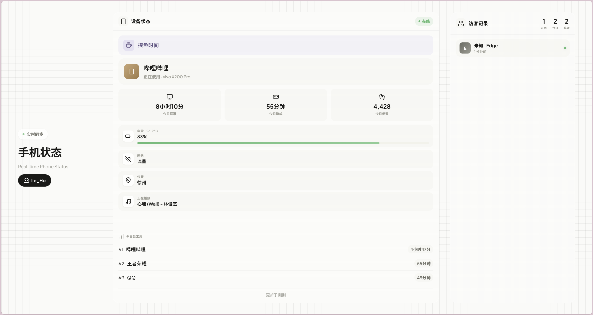
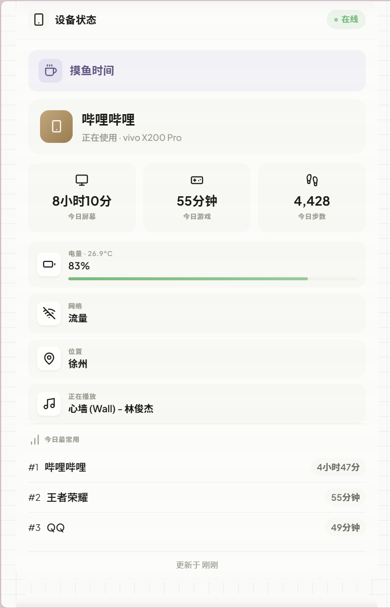
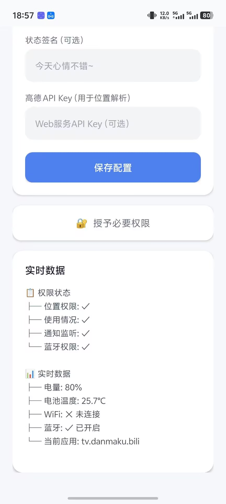

# 📱 EgoGaze - 个人手机状态实时镜像

[简体中文](./README.md) | [English](./README_EN.md)

**EgoGaze (自我凝视)** 是一个简洁、优雅、完全自托管的个人数字自画像系统。它将你手机的物理状态实时“镜像”到网页端，包括电量、位置、步数、应用使用时长及音乐律动。

## 🔗 实时预览 (Live Demo)

- **访问地址**：[https://s.dwill.top](https://s.dwill.top)
- **⚡ 重要说明**：由于服务端采用纯 IPv6 环境部署，请确保访问端（手机流量、热点或 IPv6 WiFi）已开启 IPv6 支持。

## 📸 项目预览 (Screenshots)

### 🖥️ Web 端 (PC & Mobile)
| PC 浏览器视图 | 移动端浏览器视图 |
| :---: | :---: |
|  |  |

### 📱 Android 客户端 (EgoGaze App)
| 状态同步 App | 实时数据详情 |
| :---: | :---: |
|  |  |

## ✨ 功能特性

- **🚀 实时同步**：毫秒级上报延迟，网页端自动刷新（304 优化）。
- **📊 精准统计**：基于 Android 系统 `UsageEvents` 重新实现的“今日使用时长”算法，彻底告别数据偏移。
- **🎵 媒体感知**：实时显示正在播放的歌曲名称及艺术家。
- **🔋 状态追踪**：电量比例、充电状态、设备温度、内存占用一目了然。
- **🛡️ 隐私至上**：全链路自托管，数据仅在你的私人服务器与手机之间流动。

---

## 📥 部署指南 (Deployment)

### 1. 服务端部署 (Server)
推荐使用 **Docker** 方案，适合 NAS 或全天开机的电脑。

- **快速启动**：
  ```bash
  cd phone-status/self-hosted
  docker-compose up -d --build
  ```
- **[点击查看详细的反代与配置指南](./phone-status/self-hosted/README.md)**。

### 2. 手机端 App 部署 (Android) - 核心
这是数据同步的源头，必须正确配置并安装。

- **源码编译**：
  1. 使用 Android Studio 打开 `phone-status/android` 目录。
  2. 在左下角 `Build Variants` 中选择 **`selfhostedDebug`**。
  3. 编译并安装 APK 到手机。
- **初始化配置**：
  1. 打开 App，输入你的 API 地址（例如 `https://s.dwill.top/api/update`）。
  2. 输入 API Key（默认在 `docker-compose.yml` 中设置）。
  3. **[重要] 赋予权限**：点击 App 中的权限检查项，手动开启“忽略电池优化”、“使用情况访问”及“通知监听”。
  4. 点击 **[启动服务]**。
- **[点击查看：Android 保活与避坑指南](./phone-status/docs/android_pitfalls.md)**

### 3. 零成本方案：Cloudflare 部署
适合没有公网 IP 的用户。[点击查看：Cloudflare 部署教程](./phone-status/docs/cloudflare_deploy.md)。

---

## 🛠️ 开发与本地调试

### 1. 软件环境
- **Android**: 核心开发与测试机为 **Vivo (Android 14 / OriginOS)**。
- **Server**: Node.js 18+ (服务端使用 TypeScript 开发)。

### 2. 开发者文档
- **[本地开发环境搭建](./phone-status/docs/local_debug.md)**


## 📜 许可证 (License)

Distributed under the MIT License. See `LICENSE` for more information.
